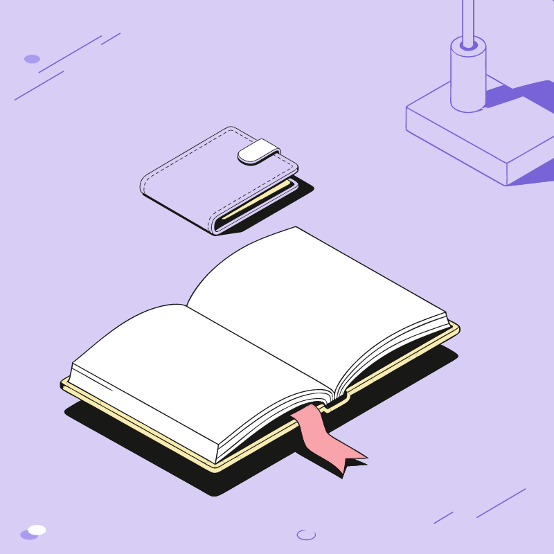
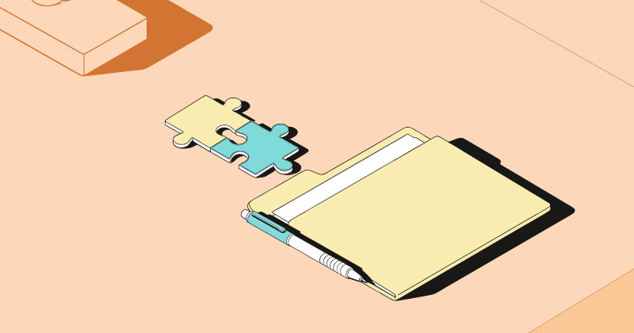
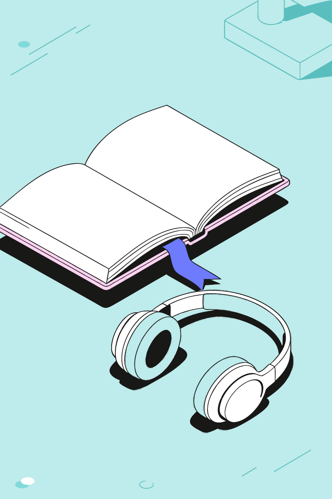

# Конструктор иллюстраций

Тестовое задание для ООО «Студия Очень» · Junior AI Developer · Nikolai Kondakov · [@tankionline2005](https://t.me/tankionline2005)

**Сервис:** https://beyondbirthday.cc

Веб-сервис собирает векторные иллюстрации из готовых изометрических объектов студийной библиотеки. Объекты не
генерируются и не перерисовываются: каждый копируется из исходного SVG как есть. Меняются только место, поворот,
порядок слоёв, роль (главный или фоновый) и цвета внутри палитры.

- **Сценарий 1 — по смыслу.** Пишете метафору или заголовок, ИИ выбирает подходящие объекты, раскладка собирает из
  них кадр.
- **Сценарий 2 — по названиям.** «книга, телефон, две монеты, лампа фоном» — объекты распознаются без ИИ (в любом
  падеже, с числами и пометкой «фоном»), дальше та же раскладка.
- **Редактор:** перемещение, поворот (за ручку или двумя пальцами), копия, удаление, слои, смена роли, вариант цветов
  объекта, отмена и повтор, горячие клавиши.
- **Форматы** из примеров дизайнеров: 1000×1000, 1200×630, 800×1200. **Размеры** объектов: крупный и мелкий набор,
  с автовыбором.
- **Палитры:** три схемы библиотеки и свои — вставить hex-коды или JSON, загрузить файл, взять цвета с картинки.
  Композиция перекрашивается сразу, правила схемы проверяются.
- **Экспорт в SVG:** вектор, каждый объект — отдельная группа с именем («Книга (главный)»), открывается в Figma
  слоями.

## Примеры

Объекты выбраны настоящими ответами ИИ сервиса (`scripts/examples-ai.json`), раскладка — движком
(`scripts/make-examples.ts`).

| «Финансовая грамотность для начинающих» | «Командная работа над сложным проектом» | «Подкаст для тех, кто учится по вечерам» |
|---|---|---|
|  |  |  |
| книга, кошелёк, лампа фоном · 1000×1000 · сиреневая | пазл, папка, ручка, лампа фоном · 1200×630 · персиковая | наушники, книга, лампа фоном · 800×1200 · бирюзовая |

SVG лежат рядом: [examples/](examples/).

## Архитектура

```
library/src/{large,small}/{main,bg}/*.svg   40 объектов, экспорт из Figma
library/src/tiles/…                         подложки трёх схем
library/meta.json                           названия, синонимы, смыслы, схемы
scripts/build-library.mjs                   библиотека → web/src/library (генерируется при сборке)
web/                                        React + TypeScript + Vite, интерфейс на ките iOS/Telegram
  src/engine/                               библиотека, сцена → SVG, раскладка, распознавание слов
  src/compose/                              сценарий сборки и окно с живым статусом
server/app.py                               FastAPI: /api/compose → OpenRouter, ответ потоком (SSE)
```

### Хранение, извлечение и переиспользование SVG

1. **Извлечение.** Каждый из 40 объектов экспортирован из Figma отдельным SVG (10 предметов × главный/фоновый ×
   крупный/мелкий). Скрипт `build-library.mjs` читает пути и **не трогает геометрию** — атрибут `d` копируется как
   есть. Единственное изменение — цвет: каждый hex заменяется своей ролью в палитре (`$bg1`, `$obj2`…). Цвет вне
   палитры останавливает сборку, чтобы схема не ломалась незаметно.
2. **Хранение.** Результат — `manifest.json` (имена, смыслы, размеры, маски) и тела объектов по размерам
   (`bodies-large.json`, `bodies-small.json`, подгружаются по требованию). Для каждого объекта строится маска
   занятых клеток (где есть краска, включая тень) — по ней раскладка меряет перекрытия и обрезку настоящим
   силуэтом, а не прямоугольником.
3. **Переиспользование.** В сцене объект — ссылка на тело плюс место, поворот, роль и вариант цветов. При отрисовке
   и экспорте роли подставляются цветами палитры, поэтому перекраска в любую схему не требует новых файлов. Главная
   и фоновая версии одного предмета одного размера, поэтому роль меняется на месте. Подложка — заливка плюс
   декор, привязанный к углам, поэтому на 1200×630 и 800×1200 он не растягивается.

### Раскладка

Правила сняты с 16 кадров из «Примеров композиций»: я нашёл в них те же контуры, что в библиотеке, и восстановил
точные координаты каждого объекта (`scripts/examples-placements.json`). Выяснилось:

- объекты стоят в масштабе 1 — крупно и с выходом за край;
- главные почти целиком в кадре, большая книга или папка может быть обрезана наполовину;
- фоновый уходит вверх или в угол;
- телефон, пазл или ручку можно положить на книгу или папку;
- ничего не касается края «впритык».

Движок (`web/src/engine/layout.ts`) ищет расстановку имитацией отжига по маскам. Оценка складывается из этих
правил плюс глубины (что ближе к зрителю, рисуется поверх), равновесия, заполненности и цельности группы. Кадры
дизайнеров по этим правилам получают небольшой штраф (около 15 на все 16 кадров) — так я проверял, что правила
описывают их стиль, а не мои вкусы (`npm run layout` рисует сравнение). Расчёт идёт в Web Worker, около 0,3–0,6 с; новый seed — «Другой вариант».

### ИИ

Сервер просит у бесплатной модели **NVIDIA Nemotron 3.5 Super (OpenRouter)** строгий JSON по схеме: 1–3 главных и
0–2 фоновых объекта из фиксированного списка, название и объяснение. Модель только выбирает — рисует движок. Ход
рассуждений модели транслируется в браузер (SSE) и показывается живым статусом поверх WebGL-сферы. Если модель не
ответила за 95 секунд, перегружена или ответила не по формату, объекты подбирает локальный словарь смыслов, и
интерфейс это честно сообщает. Есть лимиты на посетителя и на сутки, чтобы не израсходовать бесплатную квоту.

## Запуск

```bash
cd web
npm install
npm run dev        # http://localhost:5173, /api проксируется на боевой сервер
```

Свой API: `pip install -r server/requirements.txt`, затем
`OPENROUTER_API_KEY=… uvicorn app:app --port 8000` в `server/`, и `API_URL=http://127.0.0.1:8000 npm run dev`.

Сервер: Ubuntu 24.04, nginx за Cloudflare (Full strict, сайт открыт только сетям Cloudflare), API — служба systemd
(`server/ochen-api.service`) на 127.0.0.1:8000. Выкладка — `sh scripts/deploy.sh`.

## AI-инструменты

- **Claude Code (модель Claude Opus 5.5)** — разработка целиком: разбор материалов задания, сборщик библиотеки,
  движок раскладки и его сверка с кадрами дизайнеров, интерфейс, сервер, настройка VPS.
- **NVIDIA Nemotron 3.5 Super через OpenRouter** — в самом сервисе: подбор объектов по метафоре.
- Интерфейс построен на моём ките в стиле iOS/Telegram (скилл telegram-ios-web-ui), который я использую в своих
  проектах.
